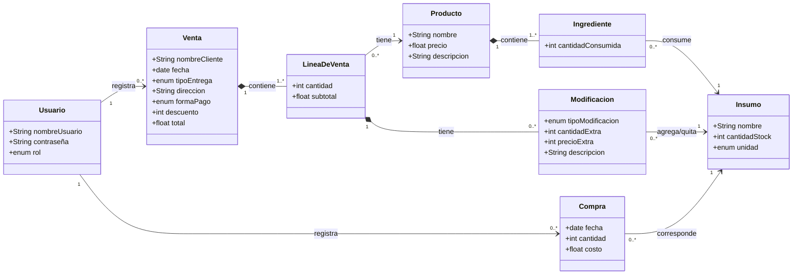
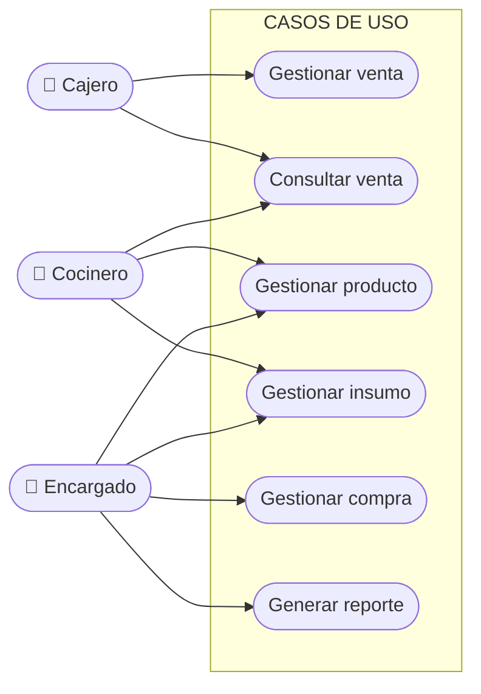
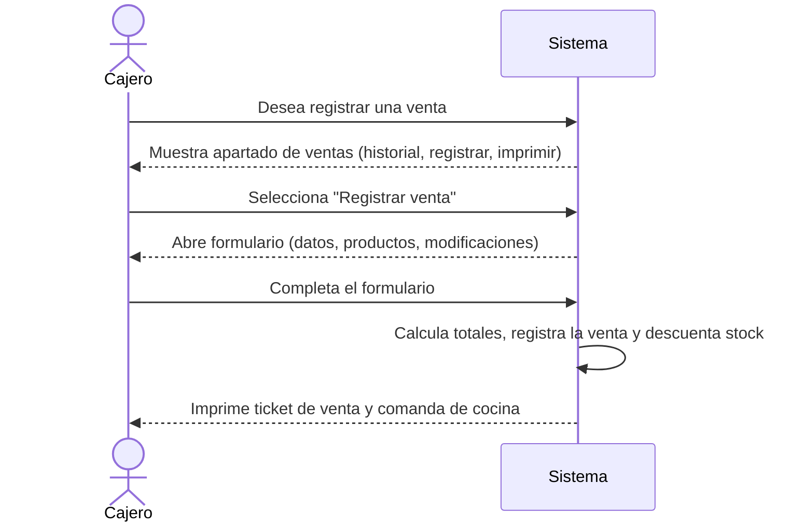

## Tema del proyecto: Sistema de Gestión de Local de Comida

**Estudiante:** Gonzalez Braian Exequiel
**Fecha:** 30/07/26

---

## Índice

1. [Descripción del problema y propuesta del sistema](#1-descripción-del-problema-y-propuesta-del-sistema)
2. [Investigación y entrevistas realizadas](#2-investigación-y-entrevistas-realizadas)
3. [Enunciado del proceso de información actual](#3-enunciado-del-proceso-de-información-actual)
4. [Identificación de actores](#4-identificación-de-actores)
5. [Identificación de datos](#5-identificación-de-datos)
6. [Identificación de entidades](#6-identificación-de-entidades)
7. [Diagrama de clases](#7-diagrama-de-clases)
8. [Diagrama de casos de uso](#8-diagrama-de-casos-de-uso)
9. [Desarrollo detallado de casos de uso relevantes](#9-desarrollo-detallado-de-casos-de-uso-relevantes)
10. [Prototipo del sistema (bocetos)](#10-prototipo-del-sistema-bocetos)
11. [Conclusiones](#11-conclusiones)

---

## 1. Descripción del problema y propuesta del sistema

### 1.1 Descripción de la organización o contexto

El proyecto se desarrolla en el contexto de un emprendimiento gastronómico dedicado a la venta de hamburguesas, cuyo canal de pedidos es principalmente WhatsApp y llamadas telefónicas, con entrega por delivery o retiro. Actualmente toda la gestión de ventas, productos, insumos y reportes se realiza de forma manual y en papel.

### 1.2 Problema identificado

El negocio no cuenta con un sistema informático que centralice la información operativa. Las ventas, productos, insumos y el registro de compras de insumos se llevan en papel y notas virtuales de forma independiente entre sí, lo que dificulta la producción.

### 1.3 Objetivos del sistema propuesto

- **Objetivo general:** Informatizar la gestión interna del emprendimiento gastronómico, mediante la administración de ventas, productos, insumos, historial de registros, generación de comandas y tickets.
- **Objetivos específicos:** registrar ventas, productos e insumos, descontar automáticamente los ingredientes del stock (incluyendo modificaciones detalladas en la venta) e imprimir el ticket y la comanda de cocina. También registrar las compras de insumos y generar reportes por períodos seleccionados.

### 1.4 Alcance del sistema

- **Incluido:** registro de ventas con sus respectivos detalles, gestión de productos, gestión de stock de ingredientes, impresión de comandas y tickets, registro de compras de insumos, consulta de reportes.
- **Fuera de alcance:** aplicación de pedidos online, integración de pasarela de pago online, gestión de clientes, sucursales, contabilidad como facturación electrónica e impuestos y sueldos.

---

## 2. Investigación y entrevistas realizadas

### Entrevista 1

| Persona entrevistada | Rol | Fecha | Objetivo de la entrevista |
|---|---|---|---|
| Yulian | Encargado/cocinero | 15/07/26 | Conocer el proceso administrativo general. |

| Pregunta realizada | Resumen de respuesta | Conclusión obtenida |
|---|---|---|
| ¿Cómo se reciben y registran los pedidos? | El cajero recibe por WhatsApp o llamada telefónica y se anota manualmente en papel. | El sistema debe permitir cargar una venta con sus detalles. |
| ¿Cómo se gestionan los productos ofrecidos? | El cocinero se encarga de registrar en papel los productos con sus respectivos ingredientes. | El sistema debe permitir registrar los productos y asociarlos a sus respectivos ingredientes. |
| ¿Cómo se controla el stock de insumos para la producción? | Se controla de forma visual a medida que se vende, si falta un ingrediente se cancelan pedidos. | Es necesario un control de stock en tiempo real con descuento automático por venta. |
| ¿Se registran gastos de insumos? | Se guarda el ticket de compra o se anota en papel lo que se compró y el gasto total. | El sistema debe permitir cargar el detalle de cada compra y actualizar el stock automáticamente. |
| ¿Cómo se controlan los movimientos, ingresos y gastos de un periodo de tiempo? | Se realizan cálculos manuales mediante los registros de ventas y compras de insumos. | El sistema debe generar reportes automáticamente en un periodo seleccionado con información útil. |

### Entrevista 2

| Persona entrevistada | Rol | Fecha | Objetivo de la entrevista |
|---|---|---|---|
| Luz | Cajero | 16/07/26 | Conocer el proceso de registro de pedidos y cobro. |

| Pregunta realizada | Resumen de respuesta | Conclusión obtenida |
|---|---|---|
| ¿Qué datos se anotan cuando llega un pedido? | Producto, modificaciones, total, forma de pago y si es con dirección de envío o retiro. | El registro de venta debe incluir los detalles del pedido. |
| ¿Cómo se calcula el total si incluye modificaciones en el pedido? | Se calcula manualmente sumando cada extra. | El sistema debe calcular automáticamente el total según el producto y sus modificaciones. |
| ¿Cómo se comunica la venta a la cocina? | Se escribe una nota para la cocina y el delivery por cada pedido. | El sistema debe generar automáticamente un ticket de venta con toda la información y una comanda para la cocina. |

### Entrevista 3

| Persona entrevistada | Rol | Fecha | Objetivo de la entrevista |
|---|---|---|---|
| Sofia | Cocinero | 16/07/26 | Conocer el proceso administrativo de insumos y comandas. |

| Pregunta realizada | Resumen de respuesta | Conclusión obtenida |
|---|---|---|
| ¿Hay forma de controlar insumos para la producción? | No, se verifica al momento de producir, y se notifica si hay que cancelar. | El sistema debe permitir mostrar y gestionar los insumos existentes, también evitar el registro de una compra si no hay insumos disponibles. |
| ¿Qué pasa si una nota se pierde? | Se verifica en el cuaderno de ventas y se produce. | El sistema debe permitir consultar e imprimir ventas anteriores. |

---

## 3. Enunciado del proceso de información actual

- **Descripción detallada del proceso actual:** Los pedidos se reciben por WhatsApp o llamada telefónica y se registran como ventas a mano en papel, con detalles, modificaciones, precio unitario, total, dirección de envío o retiro. Por cada venta se confecciona además una comanda en papel que se envía a la cocina para la elaboración de los productos. Si el pedido es con envío, se entrega al delivery otra nota con el nombre del cliente y la dirección. El pago se realiza en efectivo o por transferencia. El stock de ingredientes se controla de manera visual, a medida que se vende, y cuando no hay ingredientes disponibles se cancelan pedidos y se dejan de recibir nuevos hasta reponer. Las compras de insumos se anotan en papel indicando qué se compró y el gasto total, sin desglose por ingrediente ni actualización de stock.

- **Herramientas utilizadas actualmente:** WhatsApp / llamadas telefónicas para recibir pedidos, calculadora, notas virtuales, papel y lapicera.

- **Tareas manuales realizadas:** Anotar cada pedido con detalles, redactar una comanda para la cocina, redactar una nota adicional para el delivery, estimar visualmente el stock disponible de ingredientes, anotar en papel las compras de insumos y su costo total, calcular manualmente los gastos, ingresos, efectivo y las transferencias en un periodo determinado.

- **Problemas y limitaciones detectadas:**
  - No hay control real del inventario de insumos e historial de compras (fechas, costos por insumo, cantidad, total), sólo estimación visual o anotaciones.
  - Cancelaciones de pedidos y cierre de producción por falta de stock no anticipada, registro de compras sin relación con el stock existente.
  - Existe redundancia de tareas manuales (venta, comanda y nota de delivery por separado) e imposibilidad de generar reportes de ventas del negocio sin procesar todo a mano.
  - Riesgo de pérdida o ilegibilidad de las notas en papel.

---

## 4. Identificación de actores

| Actor | Tipo | Descripción | Responsabilidades |
|---|---|---|---|
| Encargado | Usuario | Administra el negocio. | Gestionar insumos, productos, compras y consultar reportes. |
| Cajero | Usuario | Recibe el pedido y carga la venta en el sistema. | Registrar ventas, imprimir y entregar ticket de venta y comanda para cocina. |
| Cocinero | Usuario | Encargado de preparar los productos. | Consultar ventas e imprimir la comanda generada por el sistema, gestiona insumos y productos. |

---

## 5. Identificación de datos

| Dato | Descripción | Origen | Utilidad dentro del sistema |
|---|---|---|---|
| Datos de venta | Contiene todos los detalles de una venta. | Pedido del cliente. | Registro de ventas, comanda, ticket, reportes. |
| Datos de producto | Contiene todos los detalles del producto y sus ingredientes. | Receta que conforma el producto. | Registro de catálogo de productos, consumo de stock de insumos. |
| Datos de insumo | Contiene detalles de los insumos. | Ingredientes u otros insumos de producción. | Control de inventario de insumos. |
| Datos de compra de insumos | Contiene detalles de las compras realizadas. | Compras y gastos de producción. | Control de inventario de insumos e historial de compras. |

---

## 6. Identificación de entidades

| Entidad | Descripción | Atributos principales |
|---|---|---|
| Venta | Representa una transacción física. | nombreCliente, fecha, tipoEntrega (retiro-delivery), direccion, formaPago (efectivo-transferencia), descuento, total |
| LineaDeVenta | Representa la composición de productos individuales en cada venta. | cantidad, subTotal |
| Producto | Representa los productos ofrecidos. | nombre, precio, descripción |
| Ingrediente | Representa la relación de composición de un producto con los insumos. | cantidadConsumida |
| Insumo | Representa los insumos disponibles que pueden ser consumidos por productos y modificaciones o agregados por compra o de forma manual. | nombre, cantidadStock, unidad (gramos, feta, rodaja, etc.) |
| Modificacion | Representa la quita de ingredientes o agregados extras en un producto seleccionado en una línea de venta. | tipoModificacion (agregar-quitar), cantidadExtra, precioExtra, descripcion |
| Compra | Representa los detalles de la compra de un insumo. | fecha, cantidad, costo |
| Usuario | Representa los usuarios que manejan el sistema. | nombreUsuario, contraseña, rol (encargado, cocinero, cajero) |

---

## 7. Diagrama de clases



**Flujo de Venta:** Un Usuario registra una Venta nueva en el sistema, indicando los datos generales, esta Venta se divide en varias LineaDeVenta que apunta al Producto, el sistema necesita saber de qué está hecho y apunta a la clase Ingrediente (que actúa como receta) y verifica qué Insumo consume y en qué cantidad.

**Excepciones:** Si el cliente pidió un cambio (ej: "extra queso" o "sin tomate"), el sistema revisa la clase Modificacion unida a esa línea de venta para saber qué Insumo específico debe agregar o quitar del cálculo. Finalmente el sistema resta las cantidades utilizadas de cantidadStock en la clase Insumo.

**Flujo de Compra:** Un usuario realiza una compra de Insumos y registra los detalles mediante la clase Compra que apunta de manera directa al Insumo adquirido y simplemente suma la cantidad comprada al atributo cantidadStock de la clase Insumo.

---

## 8. Diagrama de casos de uso



---

## 9. Desarrollo detallado de casos de uso relevantes

### Gestionar ventas

| Campo | Descripción |
|---|---|
| **Caso de uso** | Gestionar ventas |
| **Objetivo** | Registrar e imprimir una venta, consultar historial. |
| **Actor principal** | Cajero. |
| **Actores secundarios** | Cocinero. |
| **Precondiciones** | Productos e insumos disponibles. |
| **Postcondiciones** | Venta registrada en el historial de ventas, stock de insumos actualizado. |
| **Flujo principal** | 1. El caso de uso comienza cuando el cajero desea registrar una venta.<br>2. El sistema muestra el apartado de venta con historial y opción para registrar una venta o imprimir ventas anteriores.<br>3. El cajero selecciona registrar venta.<br>4. El sistema abre un formulario para rellenar datos, selección de productos y sus modificaciones.<br>5. El cajero completa el formulario.<br>6. El sistema realiza los cálculos correspondientes, registra la venta e imprime el ticket de venta y la comanda para la cocina. |
| **Flujos alternativos** | Consultar e imprimir ventas anteriores. |



### Gestionar productos

| Campo | Descripción |
|---|---|
| **Caso de uso** | Gestionar productos |
| **Objetivo** | Registrar, eliminar o modificar los productos y asociar los insumos necesarios para su producción. |
| **Actor principal** | Cocinero. |
| **Actores secundarios** | Encargado. |
| **Precondiciones** | Insumos disponibles. |
| **Postcondiciones** | Producto registrado. |
| **Flujo principal** | 1. El caso de uso comienza cuando el cocinero o el encargado desea registrar un producto para ofrecer.<br>2. El sistema muestra en el apartado de productos una opción para registrar uno nuevo y una lista de productos ya registrados que se pueden modificar o borrar.<br>3. El cocinero o el encargado selecciona registrar producto.<br>4. El sistema muestra un formulario para cargar sus datos y seleccionar los insumos necesarios para la producción y en qué cantidad.<br>5. El cocinero completa el formulario y confirma el producto.<br>6. El sistema registra el producto en el catálogo. |
| **Flujos alternativos** | Modificar o eliminar un producto ya existente. |

### Gestionar insumos

| Campo | Descripción |
|---|---|
| **Caso de uso** | Gestionar insumos |
| **Objetivo** | Registrar, modificar, eliminar o ajustar manualmente la cantidad en stock de insumos. |
| **Actor principal** | Cocinero. |
| **Actores secundarios** | Encargado. |
| **Precondiciones** | - |
| **Postcondiciones** | Insumo disponible. |
| **Flujo principal** | 1. Este caso de uso comienza cuando el encargado o el cocinero desean registrar un insumo.<br>2. El sistema muestra en el apartado de inventario, en la sección de insumos, una opción para registrar insumo y una lista de insumos ya registrados que se pueden modificar o borrar.<br>3. El encargado o cocinero selecciona registrar insumo.<br>4. El sistema muestra un formulario con los datos necesarios para rellenar.<br>5. El encargado o cocinero completa el formulario y confirma.<br>6. El sistema guarda el insumo. |
| **Flujos alternativos** | Modificar o eliminar un insumo ya existente. Ajustar manualmente la cantidad de stock de un insumo registrado. |

### Gestionar compras

| Campo | Descripción |
|---|---|
| **Caso de uso** | Gestionar compras |
| **Objetivo** | Registrar o eliminar compra, visualizar historial de compras. |
| **Actor principal** | Encargado. |
| **Actores secundarios** | - |
| **Precondiciones** | Insumo registrado. |
| **Postcondiciones** | Historial de compra y stock de insumo actualizado. |
| **Flujo principal** | 1. Este caso de uso comienza cuando el encargado desea registrar una compra.<br>2. El sistema muestra en el apartado de inventario, en la sección de compras, una opción para registrar una compra y un historial de compras anteriores.<br>3. El encargado selecciona registrar compra.<br>4. El sistema muestra un formulario con los datos necesarios para rellenar y seleccionar los insumos adquiridos.<br>5. El encargado completa el formulario y confirma.<br>6. El sistema guarda la información de la compra y actualiza el stock de insumos. |
| **Flujos alternativos** | Ajuste manual de insumo o eliminar registro de compra. |

### Generar reporte

| Campo | Descripción |
|---|---|
| **Caso de uso** | Generar reporte |
| **Objetivo** | Generar o exportar reportes de ventas, ingresos y gastos. |
| **Actor principal** | Encargado. |
| **Actores secundarios** | - |
| **Precondiciones** | Registros históricos del negocio. |
| **Postcondiciones** | Reporte de información seleccionada. |
| **Flujo principal** | 1. Este caso de uso comienza cuando el encargado desea generar reportes del negocio.<br>2. El sistema muestra en el apartado de reportes un formulario que permite seleccionar un periodo y el tipo de reporte que se desea generar (ventas, ingresos en efectivo, transferencia, gastos).<br>3. El encargado completa el formulario.<br>4. El sistema genera el reporte automáticamente. |
| **Flujos alternativos** | - |

---

## 10. Prototipo del sistema (bocetos)

### Ventas

```text
┌──────────┬────────────────────────────────────────────────────┐
│ STREET   │ Ventas                                             │
│ BURGER   ├────────────────────────────────────────────────────┤
├──────────┤ [ HOY ]                          [ Registrar venta ]│
│ VENTAS   │ ┌────────────────────────────────────────────────┐ │
│ PRODUCTOS│ │  #    nombre    tipo     total      acciones   │ │
│ INVENTARIO│ │  #1   Braian    Retiro   $10.000  [Ver/Imprimir]│ │
│ REPORTES │ │                                                │ │
│          │ └────────────────────────────────────────────────┘ │
└──────────┴────────────────────────────────────────────────────┘
```

### Productos

```text
┌──────────┬────────────────────────────────────────────────────┐
│ STREET   │ Productos                                          │
│ BURGER   ├────────────────────────────────────────────────────┤
├──────────┤                                 [ Registrar producto]│
│ VENTAS   │ ┌────────────────────────────────────────────────┐ │
│ PRODUCTOS│ │  #   nombre      precio   descripcion  acciones │ │
│ INVENTARIO│ │  #1  Americana   $9.000   ...   [Modificar/Eliminar]│
│ REPORTES │ │      Doble                                     │ │
│          │ └────────────────────────────────────────────────┘ │
└──────────┴────────────────────────────────────────────────────┘
```

### Inventario

```text
┌──────────┬────────────────────────────────────────────────────┐
│ STREET   │ Inventario                                         │
│ BURGER   ├──────────────────────────┬─────────────────────────┤
├──────────┤ (•) Insumos              │ ( ) Compras             │
│ VENTAS   ├──────────────────────────┴─────────────────────────┤
│ PRODUCTOS│ [ Registrar insumo ]                               │
│ INVENTARIO│ ┌───────────────────────────────────────────────┐ │
│ REPORTES │ │  #    nombre   cantidad  unidad   acciones     │ │
│          │ │  #1   Carne    2000      gramos [Modificar/Eliminar]│
│          │ └───────────────────────────────────────────────┘ │
└──────────┴────────────────────────────────────────────────────┘
```

### Reportes

```text
┌──────────┬────────────────────────────────────────────────────┐
│ STREET   │ Reportes                                           │
│ BURGER   ├────────────────────────────────────────────────────┤
├──────────┤ [Fecha desde]   [Fecha hasta]   [Tipo de reporte]  │
│ VENTAS   │ [Generar reporte] [Exportar reporte]               │
│ PRODUCTOS│ ┌────────────────────────────────────────────────┐ │
│ INVENTARIO│ │                                                │ │
│ REPORTES │ │                                                │ │
│          │ └────────────────────────────────────────────────┘ │
└──────────┴────────────────────────────────────────────────────┘
```

### Registrar venta

```text
┌──────────┬────────────────────────────────────────────────────┐
│ STREET   │ Ventas                                             │
│ BURGER   ├────────────────────────────────────────────────────┤
├──────────┤  ┌─ Registrar venta ────────────────────────────┐  │
│ VENTAS   │  │ Tipo de pedido                               │  │
│ PRODUCTOS│  │ [ Retiro/Envio ]                             │  │
│ INVENTARIO│ │ Nombre de cliente                            │  │
│ REPORTES │  │ [                ]                           │  │
│          │  │ Productos                                    │  │
│          │  │ [ Seleccionar producto ]                     │  │
│          │  │ [ Producto#     Subtotal    [ personalizar ] ]│  │
│          │  │ Direccion                                    │  │
│          │  │ [                ]                           │  │
│          │  │ Forma de pago                                │  │
│          │  │ [                ]                           │  │
│          │  │ Total                                        │  │
│          │  │ [                ]     [ Confirmar e imprimir ]│  │
│          │  └──────────────────────────────────────────────┘  │
└──────────┴────────────────────────────────────────────────────┘
```

---

## 11. Conclusiones

- El desarrollo de este trabajo permitió comprender los problemas que enfrenta el emprendimiento gastronómico al gestionar sus operaciones de forma manual: la falta de un control real sobre el stock de insumos y la desconexión entre las ventas, la producción y las compras generaba cancelaciones de pedidos, pérdida de información y no se conocía el estado real del negocio.
- El sistema propuesto aportaría soluciones, como la actualización automática del stock de insumos ante cada venta o compra, la generación inmediata de tickets y comandas sin redundancia de tareas manuales, y la posibilidad de contar con reportes automáticos sobre ingresos, gastos y productos más vendidos.
- Durante el desarrollo del trabajo, una de las principales dificultades fue comprender los flujos de información y traducir un proceso que hoy es informal y manual en un modelo de datos formal.
- Esta experiencia de análisis y documentación deja como aprendizaje la importancia de la etapa de relevamiento e investigación previa al desarrollo: entrevistar a los actores permitió identificar necesidades que no eran evidentes a simple vista, y ayuda a comprender primero el problema, antes que proponer una solución técnica.
